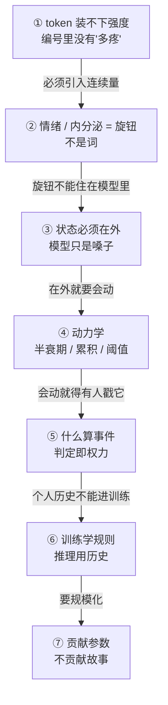

# LI：真人的数字分身

把「像一个人」拆成四个可计算的量：**档案有多厚、此刻在干什么、这次想起了什么、这几天什么底色。**

本仓库包含两篇论文与其配套代码。

## 一条链

这七篇论文不是七个题目，是一条被逼出来的链。每一步都是上一步的必然后果。



| 步 | 结论 | 在哪篇 |
|---|---|---|
| ① | token 是离散的，装不下强度 | [数字分身架构](论文/数字分身架构.md) §4 |
| ② | 强度必须是连续量，直接进状态 | [数字分身架构](论文/数字分身架构.md) §7 |
| ③ | 状态必须由模型外的进程持有 | [状态必须在外](论文/状态必须在外.md) |
| ④ | 有状态就要有衰减，半衰期就是人格 | [数字分身架构](论文/数字分身架构.md) §7.2 |
| ⑤ | 什么算事件，决定了性格往哪长 | [状态必须在外](论文/状态必须在外.md) §8.5 |
| ⑥ | 涌现发生在推理，不在训练 | [三层可训练架构](论文/三层可训练架构.md) |
| ⑦ | 一万人的贡献怎么加总 | [聚合口径](论文/聚合口径.md) |

**一句话概括整条链：**

> 不是做模型，是做**状态的形状**。模型公司做嗓子的精度，我们做人的连续性。

## 论文

| | 文件 | 内容 |
|---|---|---|
| 系统篇 | [论文/数字分身架构.md](论文/数字分身架构.md) | 档案—场景—记忆激活—内分泌四层架构，含案例研究与 21 条工程陷阱 |
| 机制篇 | [论文/场景历史叠加.md](论文/场景历史叠加.md) | 场景—历史叠加 = 概率检索，与注意力同构、可微可训练 |
| 证据 | [论文/证据_场景历史叠加.md](论文/证据_场景历史叠加.md) | 逐条文献支撑与支撑强度，含"没有证据"的诚实清单 |
| 路线 | [论文/三层可训练架构.md](论文/三层可训练架构.md) | L0/L1/L2 分层：一个人不够训，所有人加起来够；L2 只有七个标量 |
| 前提 | [论文/状态必须在外.md](论文/状态必须在外.md) | 模型不能持有状态；外部状态机是唯一手段；干预力与可移植性成反比 |
| 口径 | [论文/聚合口径.md](论文/聚合口径.md) | 一万个人的贡献怎么加总：12 类事件、7 个字段、只传参数不传故事 |
| 设计 | [论文/设计_三模块训练流程.md](论文/设计_三模块训练流程.md) | 历史/场景/想象的五阶段训练管线 |
| 战略 | [论文/战略_数字生命.md](论文/战略_数字生命.md) | 同一件事的决策版：做什么、不做什么、怎么验 |

一句话区分：机制篇回答**为什么这么建模、能不能训练**；系统篇回答**在真实产品里怎么落地、踩了哪些坑**。

## 代码

零依赖（只用 Python 标准库），每个文件自带自检：

```bash
cd 代码

python3 此刻.py              # 13 项：七种场景、叠加、行为指令
python3 激活.py              # 18 项：概率检索、抽样、去重、温度
python3 内分泌.py            # 11 项：三旋钮、增量、半衰期回归
python3 学话.py              # 16 项：口头禅、语气词、句长、标点
python3 记事.py              # 12 项：重要事件六条判据
python3 模拟链.py --自检      # 11 项：态度分布沙盘

python3 原型_可训练检索.py     # 手写反传：损失 2.36 → 0.12，准确率 0% → 100%
python3 实验_真实语料.py       # 真实对话检索实验（含置换检验）
```

全部 8 个自检项合计 **101 项断言**，无网络、无模型、无第三方库。

## 两组硬数字

**合成任务**（`原型_可训练检索.py`）：

```
损失   2.365 → 0.121
准确率   0%  → 100%（随机猜是 12%）
```

**真实语料**（论文机制篇 §6B，23 条真实对话、12 条有监督样本）：

```
          hit@1    置换检验
随机         8%    p≈0.81
手工权重    17%    p≈0.49
训练        25%    与手工只差 1 条
```

**这组数字不支持"训练更好"**——样本太少，差异只有一条。

⚠️ **真实对话含用户数据，不在本仓库中。**

仓库提供同格式的**合成示例数据**（`代码/数据_示例.json`，4 个虚构角色、15 条有效样本）用于验证流程可跑通。在示例数据上结果会**反转**：

```
随机 13%  |  手工 87%  |  训练 40%
```

原因：示例数据的标签就是"标签重合"，而手工规则本身即标签重合——**等于出了道它必赢的题**。

结论：**合成数据只能验证流程能跑、梯度正确，不能用来比较方法优劣。** 详见机制篇 §6B。

## 引用

```bibtex
@misc{li2026scenariohistory,
  title  = {场景—历史叠加的可概率化：一个可微的联想记忆框架},
  author = {LI Project},
  year   = {2026}
}

@misc{li2026digitaldouble,
  title  = {让分身像本人：一个以「档案—场景—记忆激活—内分泌」为核心的真人数字分身架构},
  author = {LI Project},
  year   = {2026}
}
```

## 外部工具（只推荐，不打包）

论文写作时用了两个工具做体检。**代码没有放进本仓库**——原仓库没有声明许可证，
默认保留所有权利，不能再分发。

| 工具 | 用途 | 安装 |
|---|---|---|
| [lucia-trend/de-ai-flavor](https://github.com/lucia-trend/de-ai-flavor) | 把 AI 味拆成七类可定位病征 + 量化扫描器 | `npx skills@latest add lucia-trend/de-ai-flavor` |
| [op7418/Humanizer-zh](https://github.com/op7418/Humanizer-zh) | 中文去 AI 味（英文 Humanizer 的汉化版） | 见仓库 README |

用它扫本仓库的论文，扫出来的真问题不是文体，是**校对**：
同一个文件的行数，在摘要、附录、README 里写了三个不同的数（100 / 180 / 实际 246）。
这类错误比 AI 味严重——因为它会被人当证据引。

## 许可证

论文文本 CC BY 4.0，代码 MIT。详见 [LICENSE.md](LICENSE.md)。

## 声明

论文与代码中的所有人名、对话、经历均为**虚构示例**，不对应任何真实用户；仓库中不含任何真实用户的档案、对话或个人信息。
