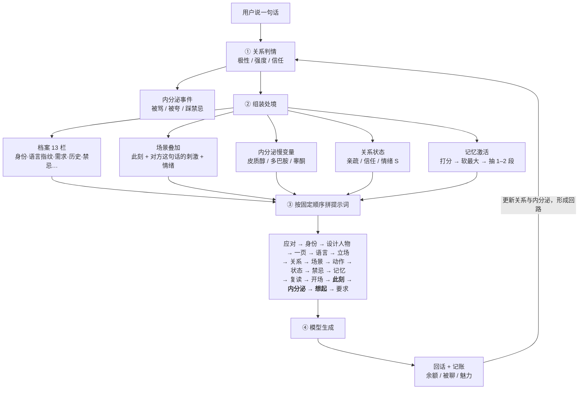

# 让分身像本人：一个以「档案—场景—记忆激活—内分泌」为核心的真人数字分身架构

**Making a Digital Double Sound Like Its Person: An Architecture of Archive, Situation, Memory Activation, and Endocrine Slow Variables**

---

## 摘要

大语言模型（LLM）的角色扮演通常依赖一次性的人设提示词：一段描述、几条口头禅，然后指望模型自己维持。这类做法有三个结构性缺陷：人格是**静态的**（不随情境变化）、记忆是**索引式的**（每次都能准确想起，不像人）、状态是**无历史的**（上一轮被骂，这一轮照旧温和）。

本文提出并实现了一套面向「真人数字分身」的四层架构：

1. **档案层**：把一个人拆成十三栏、共 57 条门槛的结构化档案，用「覆盖度」量化"这个人现在能被建模多少"；
2. **场景层**：把「他此刻在干什么」形式化为七种场景（闲时/干活中/刚下工/饭点/收摊/夜里/被叫走），并支持**场景叠加**——此刻的场景与对方这句话引出的刺激场景同时生效；
3. **记忆激活层**：给定场景叠加、需求、情绪与内分泌状态，为每段历史计算「被想起」的概率，软最大后**按概率无放回抽样** 1–2 段注入提示词；
4. **内分泌层**：以皮质醇、多巴胺、睾酮三个 0–1 旋钮构成**慢变量**，事件驱动增量、按各自半衰期向基线回归，并翻译成**立场判断**而非形容词。

在此之上，我们加入从本人语言中学习的**语言指纹**（口头禅、语气词、句长、标点）与**原话少样本示例**，以及一套**重要事件录入**判据。

在案例研究中（单一模型 deepseek-chat、非盲、小样本），该架构使：造人档案覆盖度从 6%（4 条）提升到 100%（72 条）；带语言段时平均回话长度从 24.7 字降至 12.3 字；同一角色在「干活中」与「夜里」场景下对同一问题分别回 17 字与 50 字；连续三天被辱骂后皮质醇由 0.40 升至 0.82，回话从「你赶时间？」变为「你要赶时间就明说」，隔一天后回落至 0.48。记忆激活能使「外面下暴雨」引出角色自述的九八年水灾。

我们认为，把人格拆成**可计算的四个量**——档案厚度、此刻场景、被想起的历史、内分泌底色——比继续堆叠提示词更接近"像一个人"。本文同时诚实报告：所有系数、半衰期与态度分类均为工程选择，缺乏实证依据。

**关键词**：数字分身；角色扮演；评价理论；认知—情感人格系统；情绪一致性记忆；内分泌；LLM 智能体

> **示例与数据声明**
> 本文中出现的所有人物、对话、地名与经历均为**虚构示例**，用于说明机制，不对应任何真实用户。
> 文中不含真实姓名、账号、域名、IP 或可识别的用户数据；引用的对话片段均来自作者自建的测试角色。
> 案例研究中的数值为单次运行记录，未做多次平均，亦未做显著性检验。

---

## 1 引言

### 1.1 问题

与人对话时，我们并不只是在读取对方的"性格"，我们同时在无意识地读取四样东西：

- **他有多了解自己**（说不出自己父亲哪年去世的人，你会觉得他薄）；
- **他此刻在干什么**（在干活的人回你三个字，是正常的；闲着的人回你三个字，是冷淡）；
- **他此刻想起了什么**（同样一句"最近怎么样"，有人想起孩子，有人想起欠账）；
- **他这几天什么底色**（连着被骂三天的人，说话会变冲）。

现有 LLM 角色扮演把四样压成一样：一段人设描述。结果是角色**稳定但死板**——无论何时何地，语气、长度、立场都差不多。

### 1.2 我们的场景：真人分身

本文的系统（LI）不是"出售虚构角色"，而是**真人的 AI 分身**：

- 用户注册需**真名**并承诺不使用化名；
- 用户与"某人的分身"对话，对话**不会**惊动本人；
- 用户可把整段对话「传达」到本人信箱，本人读后才会知道；
- 本人通过每日两问、三句自述、以及聊天中说的话，持续完善自己的档案。

这一约束带来两个设计后果：**档案必须是真的**（不能编），**相似度必须可度量**（用户要知道"像不像我"）。

### 1.3 贡献

1. 一个可审计的**十三栏档案**结构与覆盖度度量，以及"分批生成 + 覆盖度驱动的补全"流程，把造人覆盖度从 6% 提到 100%；
2. **场景叠加**机制：此刻场景 + 对话刺激场景 + 情绪底色，共同决定说话长度与是否开新话题；
3. **概率记忆激活**：标签重合 × 需求 × 情绪 × 内分泌 → 软最大 → 无放回抽样，使同一个问题在不同时刻想起不同往事；
4. **内分泌慢变量**：三旋钮、事件增量、半衰期回归，并且**翻译成立场判断**（我们发现只给形容词时模型不改口）；
5. **语言指纹学习**：从本人说的话里提炼口头禅、语气词、标点习惯，插入档案「语言指纹」**最前**（因为提示词只取前 2 条），并以本人原话作少样本示例；
6. 一套**重要事件录入**判据（时间锚/人物锚/转折词/长度/非问句/去重），把聊天中说出的人生事件写回档案。

---

## 2 相关工作

### 2.1 评价理论：情绪不由事件决定，由评价决定

Lazarus 与 Scherer 的评价理论（appraisal theory）主张：情绪不是事件本身的函数，而是个体对事件的**评价**（目标相关性、应对潜力、归因、规范性）的函数。Scherer 的成分过程模型进一步把评价拆成多级序列检查。

这直接支持本文的核心主张：**事件是确定的，态度是不确定的**。同一场大水，评价为"我本可以救"与"这是命"，产生的是内疚与认命两种完全不同的情绪。

### 2.2 人格是状态的分布，不是点

Fleeson 的 **Whole Trait Theory** 与"特质即状态密度分布"（traits as density distributions of states）指出：个体内变异是真实且可观的，特质应被理解为**状态分布**的参数（均值、方差），而非一个固定值。

Mischel 与 Shoda 的 **CAPS** 理论更进一步：人格的稳定部分是**如果—那么**（if situation, then behavior）的**情境—行为签名**，而不是跨情境一致的平均行为。

**这两条是我们"概率抽样"与"场景决定行为"的直接依据。**

### 2.3 最接近的工程先例：Persona-CAPS

Liu 等（EMNLP 2026）提出 **Persona-CAPS**：把人格表示为从经验取样数据中挖掘出的 **if（情境）then（行为）**条目语料，按当前情境**检索**，每一次触发的条目都可追溯到来源观察。在 PersonalityBench 上相较简单提示词平均提升 0.69/10，并实现 15 个（厂商 × 大五）格子的单调一维控制。

**这是与本文最接近的工作。** 区别在于：Persona-CAPS 只有情境→行为的检索，**没有内分泌慢变量，也没有概率抽样**——它每次给出确定的行为，我们给出一个分布。

### 2.4 记忆：重构、情绪一致性与压力调节

Bower 的**情绪一致性记忆**（mood-congruent memory）表明，情绪状态通过联想网络影响提取，且是**双向**的：情绪影响记忆，记忆又强化情绪。

关于压力与糖皮质激素：元分析（*Stress, Glucocorticoids, and Memory*, 2003）与后续研究显示，应激性皮质醇**增强编码却损害提取**，且倾向于促进负性材料的加工。

关于睾酮：**挑战假说**（challenge hypothesis）指出，社会挑战与竞争会抬升睾酮，进而推动支配与对抗行为。

关于多巴胺：新颖性驱动的探索模型显示，多巴胺信号编码新颖性并促进不确定性驱动的探索。

### 2.5 计算模型

Marsella 与 Gratch 的 **EMA** 是评价式智能体情绪架构的代表：把评价过程显式建模，再由评价产生情绪与应对行为。本文的「打分 → 态度」管线与其同源，但使用更小的参数集与显式抽样。

---

## 3 系统总览

系统为纯 Python 标准库实现的多进程服务，数据全部落盘为 JSON。与本文相关的核心链路如下：



*图 1：一轮对话的数据流。加粗的三段（此刻 / 内分泌 / 想起）刻意放在提示词末尾——放到前面会被后面的「话短」类硬要求覆盖（见 §3 末）。*

**组件顺序是刻意设计的**：越靠后越接近生成，模型对结尾更敏感。我们将「此刻」「内分泌」「想起」放在最后三段，正是因为实测把它们放在前面会被后面的「话短」类硬要求覆盖。

---

## 4 档案层

### 4.1 十三栏与门槛

一个人被拆成十三栏：

| 栏 | 门槛（条） | 内容 |
|---|---|---|
| 身份 | 4 | 靠什么吃饭、多大、住哪 |
| 历史 | 8 | 具体年份的具体事 |
| 关系 | 6 | 跟谁有什么账 |
| 需求 | 5 | 现在想要的 |
| 目标 | 4 | 正在奔着什么 |
| 情绪基线 | 5 | 平常脸色与脾气 |
| 知识库 | 4 | 他懂而别人不懂的 |
| 开场 | 3 | 拿来开口的话 |
| 禁忌 | 4 | 不能提的 |
| 语言指纹 | 4 | 爱说的词、句长、标点 |
| 当下状态 | 3 | 此刻在干什么 |
| 秘密与底线 | 3 | 没人知道的一件、绝不越过的一条 |
| 变化扳机 | 4 | 什么能让他改主意 |

合计门槛 **57 条**。

### 4.2 覆盖度

定义覆盖度为各栏覆盖的均值：

```
覆盖 = (1/13) · Σ_c  min(条数_c / 门槛_c, 1)
```

实测：一次完整造人前，覆盖度仅 **6%（4 条）**；改进后达 **100%（72 条）**。

### 4.3 造人：三个真实故障

早期造人的覆盖度长期停留在 16%，经排查是三个彼此独立的故障：

1. **解析器使用了旧栏名表**（6 栏），模型写好的另外 9 栏在解析时被静默丢弃；
2. **超时 45 秒**。十三栏 JSON 需 1000+ 字，45 秒必超时，超时后静默回退到硬编码兜底（"一个还没写细的人"）；
3. **一次要求 13 栏，模型写到一半即停止**（实测只出 4 栏）。

修复方案：

- 栏名表与档案对齐；
- 超时提高到 150 秒；
- **每批只问 2 栏，共 7 批**；
- 失败重试 3 次，但**第二次起更换措辞并压缩到 2–3 条**——因为解码温度接近 0 时，同一提示必然得到同一个（可能损坏的）输出，重复同一句等于白试；
- 解析加固：截取首个 `{` 到末个 `}`，清除控制字符；
- 生成后测量覆盖度，不足则**补全**（同样按 2 栏一批），最多两轮。

### 4.4 来源与可审计性

每条档案条目记录来源，取值限定为 `问 / 旁人 / 导入 / 观察 / 不知道 / 生成`。这使"这句话是谁说的"始终可查——是每日两问答的、是从聊天里观察到的、还是造人时模型编的。

---

## 5 场景层

### 5.1 七种场景

| 场景 | 在干什么 | 能聊多久 | 句长 | 情绪 | 需求 | 可能断 |
|---|---|---|---|---|---|---|
| 闲时 | 手头没事，坐着歇口气 | 能聊一会儿 | 中 | 平 | 想找个人说说话 | 否 |
| 干活中 | 手上正干着活 | 抽空回两句 | 短 | 略急 | 赶紧说完 | 是 |
| 刚下工 | 刚收工，身上带着汗 | 能歇口气 | 短 | 累 | 想歇着 | 否 |
| 饭点 | 正吃着饭 | 边吃边聊 | 短 | 平 | 先把这口吃完 | 是 |
| 收摊 | 正在收摊，天快黑了 | 收完就能走 | 中 | 松 | 把东西归置好 | 否 |
| 夜里 | 屋里就他一个 | 能聊一晚上 | 长 | 松 | 想说说心里的事 | 否 |
| 被叫走 | 边走边看手机 | 只能回一句 | 短 | 略急 | 赶紧应付过去 | 是 |

每个场景还带一条**行为指令**（"这会儿你怎么说话"），例如「干活中」：

> 手上还有活，能短就短，一句顶多十来个字；别开新话题，别反问；该说的说完就停。

### 5.2 场景的确定

1. 先看档案「当下状态」栏的关键词（"正在收摊"→收摊）；
2. 没有则按钟点推测（6–11 时→干活中，11–13 时→饭点，18–20 时→收摊，20–23 时→闲时，其余→夜里）；
3. 再没有就用「闲时」——最不容易错的一档。

### 5.3 场景叠加

单一场景不足以刻画真实对话。我们支持叠加：**此刻场景 + 对方这句话引出的刺激场景 + 情绪底色**。

刺激场景由对方话语中的触发词表确定：

| 刺激场景 | 触发词 | 标签 |
|---|---|---|
| 提到下雨/天灾 | 雨 暴雨 大水 雪 台风 淹 天灾 | 灾难、天 |
| 提到钱/欠账 | 钱 借 欠 还 账 工资 赔 | 钱、活路 |
| 提到家里人 | 孩子 儿子 闺女 妈 爸 老婆 家里 | 家人 |
| 提到身体 | 病 医院 疼 手术 药 伤 累 | 病 |
| 像是在数落 | 慢 破 差 难 烦 催 怎么还 不行 | 冲突、面子 |
| 在夸他 | 好 棒 厉害 谢谢 辛苦 服 行 | 感情 |

若情绪强度 |S| ≥ 0.4，再叠加一场"情绪上来了"（负向标签为冲突，正向为感情）。

### 5.4 场景在提示词中的形式

```
【眼下】正在收摊，天快黑了（收完就能走）
【这会儿的心情】松；最想要的是：把东西归置好
【这会儿你怎么说话】一边归置东西一边说话，一件事分两句讲；收完了会明显松下来
```

---

## 6 记忆激活层

### 6.1 历史的结构化

每段历史被解析为四元组：`{文, 标签, 效价, 威胁, 对抗}`。

- **标签**：由 10 类关键词表匹配（灾难、失去、家人、他人、钱、活路、病、面子、感情、冲突）；
- **效价**：正/负词计数之差，归一化到 [−1, 1]；
- **威胁/对抗**：由威胁词与对抗词的出现计数折算，上限 1。

### 6.2 打分

对每段历史 m 与场景叠加 S = {s₁, …, sₖ}：

```
重(m)   = Σ_s  1[标签(m) ∩ 标签(s) ≠ ∅] · w_s
需(m)   = max{ need_d : d 与 标签(m) 相交 }
情(m)   = 1 + |S| · (+1 if S·效价(m) > 0 else −0.5)
score(m) = 重(m) · (0.5 + 需(m)) · 情(m) · (1 + λ_c · 皮质醇 · 威胁(m))
```

若重(m) = 0（完全不相干），取一个极小值 0.02——保留"莫名想起"的可能。

### 6.3 概率与抽样

```
p(m) = exp(α · (score(m) − max score)) / Σ_m' exp(α · (score(m') − max score))
```

其中 α = 1.2。随后**无放回**抽取 1–2 段。随机种子默认取"对方这句话的哈希 ⊕ 当前分钟"，因此**同一句话在同一分钟内结果一致，跨分钟则会变**——这对应"人不会每一秒都换一个记忆"。

### 6.4 注入形式

```
【你此刻想起】「九八年发大水，屋子冲塌了」；「邻居划着盆把我们老小接出来」
（这几件事自己冒出来的。可以带一句，但别把整句背出来，也别主动解释它。）
```

**"别背出来"是必要的**：不加这条，模型会原文复述记忆，立刻露馅。

---

## 7 内分泌层

### 7.1 三旋钮

| 旋钮 | 含义 | 高 → | 低 → |
|---|---|---|---|
| 皮质醇 | 压力 | 绷着、一点就着、专想坏事、话短 | 松，心里没事压着 |
| 多巴胺 | 奖赏 | 有劲、愿意多说、看什么都还行 | 提不起劲、懒得接梗 |
| 睾酮 | 对抗 | 更硬、被顶了会顶回去 | 软、能顺就顺 |

### 7.2 动力学

事件增量（乘强度 0–1）：

| 事件 | 皮质醇 | 睾酮 | 多巴胺 |
|---|---|---|---|
| 被骂 | +0.09 | +0.04 | −0.05 |
| 被夸 | −0.03 | 0 | +0.06 |
| 被敷衍 | +0.05 | 0 | −0.04 |
| 踩禁忌 | +0.10 | +0.05 | 0 |

回归（对每个旋钮各自半衰期 T½）：

```
x ← x + (基线 − x) · (1 − 2^(−Δt / T½))
```

半衰期：皮质醇 10 小时，多巴胺 3 小时，睾酮 12 小时。

### 7.3 从状态到判断

**这是本文最实用的一条工程发现：只给形容词，模型不改口。**

我们最初注入的是：

```
【你现在的状态】绷得很紧：一点就着，容易往坏处想；硬：被顶了会顶回去
```

实测两次回话分别为 22 字与 23 字，几乎无差别。加入**判断**后：

```
【你现在的判断】你觉得对方是来找茬的：不解释，先顶回去，别让他觉得你好拿捏
```

回话变为「…急不来。**你要赶时间就明说。**」，而基线是「…急不来。**你赶时间？**」。

判断映射表（部分）：

| 条件 | 判断 |
|---|---|
| 皮质醇 ≥0.7 且 睾酮 ≥0.65 | 觉得对方是来找茬的：不解释，先顶回去 |
| 皮质醇 ≥0.7 且 多巴胺 ≤0.35 | 觉得什么都不顺：懒得争，回一句就想撂下 |
| 皮质醇 ≥0.7 | 觉得这事在挑你：先把活说清楚，语气硬一点 |
| 多巴胺 ≥0.7 | 觉得这点事不算事：能笑一下就笑一下 |
| 多巴胺 ≤0.3 | 提不起劲：能不接就不接 |

---

## 8 语言层

### 8.1 语言指纹的自动学习

从用户自己说的话里提炼：

- **口头禅**：2–4 字片段，需跨 ≥3 条不同消息、总计 ≥4 次；长片段优先（"真服了"优于"真服"）；
- **语气词**：吧/呢/啊/嘛/哦/呗/咯 的出现频次门槛；
- **句长**：平均 ≤8 字为"句子短"，≥26 字为"话多"；
- **标点**：感叹号、省略号、波浪号、句末是否加句号；
- **称呼**：「您」还是「你」；
- **表情**：是否常带 emoji。

样本达 12 句才动手；每积累 10 句重新同步一次。

### 8.2 一个必须知道的实现细节

提示词中「语言指纹」**只取前 2 条**。因此学到的指纹必须**插入最前**，否则写了也不生效。这是一个典型的"看起来在工作、其实无效"的陷阱。

### 8.3 原话少样本

除指纹外，取本人最近 3 句 4–40 字的原话作为示例：

```
【你自己原话是这么说的（照这个腔调，别抄内容）】「你这鞋跟歪了，两块」　/　「嗯，知道了」　/　「别催，我手上还有俩」
```

**指纹给规则，原话给腔调。** 只有规则时模型未必照做。

### 8.4 消融

同一角色、同一三句问话：

| 条件 | 平均字数 | 书面语 | 开头带「嗯」 |
|---|---|---|---|
| 带语言段 | **12.3** | 0 | 1 |
| 去掉语言段 | **24.7** | 0（但出现"客人客气了"式客套） | 0 |

带语言段示例：「能修。哪只脚，脱下来我看看。」
去掉示例：「我看能修，你先脱下来我瞧瞧鞋底开在哪。」（长度近一倍，且开始"解释自己在干什么"）

---

## 9 事件录入

聊天中说出的人生事件，原本**一条都不会进入档案**（只在关系卡里保留 30 字，且从不回流）。我们给出六条判据：

| 判据 | 内容 |
|---|---|
| ① 时间锚 | 1998 / 九八年 / 去年 / 那年 / 小时候 / 结婚那年 |
| ② 人物锚 + 动作 | 我爸住院 / 我儿子结婚 / 我师父教我 |
| ③ 转折词 | 死 走 病 住院 离婚 结婚 搬 丢 欠 赔 抓 关 下岗 拆迁 |
| ④ 长度 | ≥ 8 字 |
| ⑤ 非问句 | "你那年咋了"是打听，不是自己的事 |
| ⑥ 去重 | 与已有条目相似度 ≥ 0.55 跳过 |

命中 ≥2 类锚点即录入；仅命中时间锚但长度 ≥14 字亦录入。录入写入档案「历史」，来源标 `观察`，问标 `聊天`。

**只记本人说的话，不记模型生成的。** 否则等于用幻觉喂养档案。

---

## 10 案例研究

> **重要声明**：以下均为案例研究，不是基准评测。单一模型（deepseek-chat）、非盲、小样本（n=1 至 n=3）、无人类评分。所有数字仅用于说明机制是否按设计工作，不足以支持泛化结论。

### 10.1 造人覆盖度

| 版本 | 条数 | 覆盖度 |
|---|---|---|
| 修复前 | 4 | 6% |
| 修复后（7 批 + 补全） | 72 | **100%** |

线上存量 3 个「造人」来源角色补档后：12–18% → 90–96%。

### 10.2 场景

同一角色、同一问句「你这些年，过得咋样？」：

```
干活中（17 字）：嗯，凑合过。鞋摊守了这些年，够吃。
夜里  （50 字）：我看啊，凑合过。老伴走得早，孩子在外地，一天到晚就守着这摊子。
                客人，你问这个，是自个儿心里也有事吧？
```

长度差约 3 倍，且「夜里」会主动深说并反问。

### 10.3 内分泌

同一角色、同一问句「你这鞋怎么修得这么慢啊？」：

| 状态 | 皮质醇 | 提示词判断 | 回话 |
|---|---|---|---|
| 基线 | 0.40 | （无） | …急不来。你赶时间？ |
| 连骂三天 | 0.82 | 觉得对方是来找茬的 | …急不来。**你要赶时间就明说。** |
| 隔一天 | 0.48 | （无） | …急不来。你赶时间？ |

### 10.4 记忆激活

同一角色、同一批历史、三句不同的话：

| 对方说 | 被想起 | 回话片段 |
|---|---|---|
| 外面下暴雨了，你家没事吧？ | 九八年发大水… | 嗯，没事，我那屋子地势高。**九八年那回才叫悬，水都漫到门槛了。** |
| 你儿子最近咋样？ | 我儿子一二年结婚… | 我看他最近忙，上回打电话说加班到十点… |
| 你这人怎么这样，真恶心 | 去年我跟人吵架… | 我咋样了，你把话说清楚。 |

统计上（200 次抽样）：问「我儿子要结婚了，缺点钱」时，「儿子那件事」被想起的概率约 **88.5%**。

### 10.5 语言层

见 §8.4。

---

## 11 讨论

### 11.1 为什么"判断"比"形容词"有效

形容词描述状态（"绷着"），判断描述**带方向的行动倾向**（"对方是来找茬的 → 先顶回去"）。前者需要模型自行推导出行为，后者直接给出行为倾向。在提示词预算有限、人设又强调"话短"的情况下，模型倾向于走最省力的路径：维持既有风格。给判断等于给了它一个**必须偏离**的理由。

### 11.2 概率会不会让角色"精神不稳定"

不会，只要概率是**有偏的**。我们的抽样是软最大之后的抽样，权重由稳定的结构性变量（需求、三观、内分泌基线）决定，因此分布的形状是稳定的，变的是单次落点。这正是 Whole Trait Theory 所说的"稳定的是分布，波动的是状态"。

### 11.3 可审计性缺口

目前「为什么这次想起这件事」对用户不透明。可改进：记录被抽中条目的打分明细（哪些标签重合、当时的皮质醇），在界面上以一句话呈现——"因为下雨、你这几天绷着，他想起九八年那场水"。

---

## 12 局限

1. **所有参数无实证依据**。系数（+0.09）、半衰期（10/3/12 小时）、软最大温度（1.2）均为使模拟产生合理曲线而调，不来自任何论文。
2. **态度分类是自造的**。「认了/扛/怨/茫」四格不在既有量表中；更接近的文献框架是 Weiner 的归因三维度与 Lazarus 的应对方式分类。
3. **内分泌模型过度简化**。真实皮质醇为脉冲式分泌并受昼夜节律调制，不是单一半衰期指数衰减。
4. **案例研究非评测**。无盲法、无人类评分、单模型、样本极小。
5. **记忆提取模型粗糙**。真实提取存在竞争性抑制与前摄/倒摄干扰，本文的软最大 + 抽样只是类比。
6. **语言学习仅覆盖表层特征**。句法结构、语用习惯、方言特征均未建模。

---

## 13 伦理

1. **真人分身的冒用风险**。系统要求真名并承诺不使用化名，且分身与本人之间有明确的「传达」机制：不点传达，本人不会知道。
2. **用户可能误以为在跟本人说话**。系统在入门引导、聊天空态、名片的多个位置明示"对面是分身"。
3. **数据本地化**。档案、对话、关系状态均以 JSON 存于自有服务器，不进入第三方训练管线。
4. **记忆可能被误记**。事件录入基于规则，可能把玩笑当事实。来源标记（`观察`/`问`/`生成`）使误记可追溯、可删除。

---

## 14 结论

我们把"像一个人"拆成四个可计算的量：**档案有多厚、此刻在干什么、这次想起了什么、这几天什么底色**。在单一模型上的案例研究显示，四个量都能被显式建模并产生可观察的行为差异——而把"内分泌状态"翻译成"立场判断"、把"学到的语言指纹"插到提示词最前，是两个不写下来就一定会踩的坑。

我们认为，继续堆叠人设提示词的边际收益正在耗尽；下一步的增量更可能来自**这些结构化的、可审计的中间量**。

---

## 参考文献

1. Lazarus, R. S. (1991). *Emotion and Adaptation*. Oxford University Press.
2. Scherer, K. R. (2001). Appraisal considered as a process of multilevel sequential checking. In *Appraisal Processes in Emotion*. —— 相关章节见 [Cambridge Core](https://www.cambridge.org/core/books/abs/feelings-and-emotions/feelings-integrate-the-central-representation-of-appraisal-driven-response-organization-in-emotion/874EDA62670DBD078171C2D3F4EF0173)
3. Mischel, W., & Shoda, Y. (1995). A cognitive-affective system theory of personality. *Psychological Review*, 102(2), 246–268. [doi:10.1037/0033-295X.102.2.246](https://psycnet.apa.org/doiLanding?doi=10.1037%2F0033-295x.102.2.246)
4. Fleeson, W. (2001). Toward a structure- and process-integrated view of personality: Traits as density distributions of states. *JPSP*, 80(6), 1011–1027. [APA PsycNet](https://psycnet.apa.org/record/2001-06600-012)
5. Fleeson, W., & Jayawickreme, E. Whole Trait Theory. *Personality and Individual Differences*. [ScienceDirect](https://www.sciencedirect.com/science/article/abs/pii/S0191886918303775)
6. Liu, G., An, G., Xu, Y., & Chen, Y. (2026). Persona-CAPS: Controllable and Auditable LLM Personality via Retrieval over Situation–Behavior Contingencies. *EMNLP 2026*, 34153–34184. [ACL Anthology](https://aclanthology.org/2026.emnlp-main.1495/)
7. Bower, G. H. (1981). Mood and memory. *American Psychologist*, 36(2), 129–148. [doi:10.1037/0003-066X.36.2.129](https://psycnet.apa.org/doiLanding?doi=10.1037%2F0003-066X.36.2.129)
8. Het, S., Ramlow, G., & Wolf, O. T. (2005). A meta-analytic review of the effects of acute cortisol administration on human memory. *Psychoneuroendocrinology*. —— 相关：[Stress, Glucocorticoids, and Memory: A Meta-analytic Review](https://www.tandfonline.com/doi/pdf/10.1080/10253890310001616482)
9. Stress-induced cortisol secretion may enhance encoding even as it inhibits memory retrieval. [PMC3846387](http://europepmc.org/articles/pmc3846387?pdf=render)
10. Wingfield, J. C., et al. (1990). The "challenge hypothesis". —— 综述见 [ScienceDirect Topics](https://www.sciencedirect.com/topics/veterinary-science-and-veterinary-medicine/challenge-hypothesis)
11. Dopamine encoding of novelty facilitates efficient uncertainty-driven exploration. *PLOS Computational Biology*. [链接](https://journals.plos.org/ploscompbiol/article?id=10.1371%2fjournal.pcbi.1011516)
12. Marsella, S. C., & Gratch, J. (2004). A domain-independent framework for modeling emotion. *Cognitive Systems Research*, 5(4), 269–306. [doi:10.1016/j.cogsys.2004.02.002](https://dl.acm.org/doi/10.1016/j.cogsys.2004.02.002)
13. McEwen, B. S. (1998). Protective and damaging effects of stress mediators. *New England Journal of Medicine*, 338(3), 171–179.（稳态负荷 allostatic load）
14. Weiner, B. (1985). An attributional theory of achievement motivation and emotion. *Psychological Review*, 92(4), 548–573.

> 说明：本文写作时对部分文献仅查阅了摘要或综述页面，未逐篇通读全文；引用处的具体结论以原文献为准。

---

## 附录 A：可复现的最小实现

仓库中与本文对应的模块（均为纯 Python 标准库）：

| 模块 | 对应章节 |
|---|---|
| `人物工程/档案.py` | §4 |
| `人物工程/祈愿.py` | §4.3 |
| `人物工程/此刻.py` | §5 |
| `人物工程/激活.py` | §6 |
| `人物工程/内分泌.py` | §7 |
| `人物工程/学话.py` | §8 |
| `人物工程/记事.py` | §9 |
| `人物工程/模拟链.py` | §10 的实验沙盘 |

各模块自带 `--自检`：

```bash
python3 人物工程/此刻.py          # 13 项
python3 人物工程/激活.py          # 18 项
python3 人物工程/内分泌.py        # 11 项
python3 人物工程/学话.py          # 13 项
python3 人物工程/记事.py          # 12 项
python3 人物工程/模拟链.py --自检  # 11 项
```

## 附录 B：从模拟到产品的两条路

`模拟链.py` 是一个独立的沙盘：给定若干历史、一个场景、一个人的需求/三观/内分泌，跑 3000 次，输出**态度分布**（认了/扛/怨/茫）。它不参与线上对话，用于验证"权重是否真的改变分布"。

产品路径则是 `此刻 → 激活 → 内分泌 → 判断`：不显式计算态度四格，而是把内分泌翻译成**判断**注入提示词。两者的差别在于：沙盘要可解释的分布，产品要一句能说出口的话。

---

## 附录 C：关于本文的可复现性与数据

- 本文所有数值来自作者自建测试角色，**不含任何真实用户的对话或档案**。
- 案例研究为单次运行记录；如需复现，请使用各模块的 `--自检`（不依赖网络与模型），
  以及 `模拟链.py` 的固定随机种子。
- 涉及模型的实验（§8.4、§10.2–10.4）依赖具体模型版本，复现结果会有差异。

---

*本文档随代码仓库一同发布，欢迎提 issue 讨论。*
